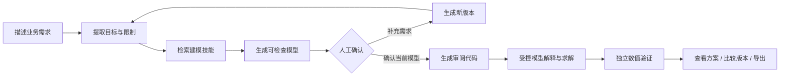

# OptiFlow 产品需求文档（PRD）

版本：v1.1 · 本地可运行 MVP；更新：2026-10-28；面向产品评审、开发协作和作品集展示。

P0 体验迭代更新：2026-10-29。模型复核采用业务语言优先、技术信息折叠；结果采用确定性摘要和保守可比性判定；新增本地匿名可用性测试。不变更 Agent、技能库、求解器或模型确认协议，详见 [本轮交付](docs/P0-DELIVERY.md)。

在线测试部署扩展：已增加单实例统一数据库、专属邀请和管理员导出，供异地参与者访问同一服务。此扩展不是完整的多租户协作系统，目前未实际部署公网环境，参见 [部署范围与验收边界](docs/ONLINE-STUDY.md)。

## 1. 产品定位

**用户用自然语言描述业务目标与资源限制，OptiFlow 生成可检查的优化模型，经用户确认后求解、验证并沉淀决策方案。**

产品切入生产计划、资源分配和人员排班。它把业务意图、数学表达与求解结果放在同一个工作空间，重点解决“模型可以运行，却未表达真实业务要求”的信任缺口。

当前定位为本地单用户平台。目标用户与需求来自产品假设和案例分析，尚未经独立用户访谈、真实企业部署或收益评估验证。

## 2. 用户与场景

| 角色 | 工作任务 | 主要障碍 | 平台提供的支持 |
| --- | --- | --- | --- |
| 生产计划人员 | 安排产品产量与设备工时 | 资源约束多，新增条件易遗漏 | 原文与模型对照、补充约束、重算方案 |
| 运营 / 业务分析人员 | 分配预算、人力等有限资源 | 目标与限制难以转换成数学模型 | 自然语言入口、案例模板、结构化模型 |
| 决策复核人员 | 判断方案是否符合业务要求 | 只看到最终答案，无法追溯 | 模型确认、约束残差、版本与报告 |
| 产品维护者 | 定位失败并迭代 | 失败原因散落在日志中 | 阶段事件、Badcase 分类与跟进 |

首个完整演示场景选“工厂生产计划”，因为目标、资源和决策量可清楚表达，修改一条约束就能展示决策变化。

## 3. 从痛点到产品价值

| 原来的工作障碍 | 对应设计 | 价值假设 | 当前真实程度 |
| --- | --- | --- | --- |
| 不知道如何完整描述需求 | 类别、业务模板、输入提示 | 降低第一次使用门槛 | 已实现 |
| 等待时不知道系统在做什么 | 六阶段状态与实际耗时 | 降低过程不透明带来的不确定性 | 已实现 |
| AI 遗漏约束但仍给出答案 | 模型原文依据、人工确认节点 | 让用户在求解前检查业务含义 | 已实现；效果待用户研究 |
| 补充要求后旧答案仍被使用 | 版本快照、确认指纹、新版本撤销旧结果 | 减少过期方案误用 | 已实现 |
| 求解成功被误解为业务正确 | 求解状态、数值检查、人工复核分开展示 | 建立更准确的信任边界 | 已实现 |
| 失败不能沉淀 | Badcase 状态、处理说明与事件 | 支持持续定位与迭代 | 已实现 |

## 4. 核心任务流程

人工确认对象包括：变量、目标、约束、边界、单位和假设。确认只记录用户对业务表达的复核，不构成数学正确性证明。

## 5. 页面与优先级

| 模块 | 核心操作 | 优先级 | 验收条件 |
| --- | --- | --- | --- |
| 工作台总览 | 查看本机指标、最近任务、场景模板 | P1 | 首次使用不预填虚构任务；入口可到达对应操作 |
| 新建优化任务 | 自然语言输入、类别选择、加载案例 | P0 | 自定义文本能进入实时建模；案例编辑后不会套用旧模板 |
| Agent 工作流 | 查看六阶段状态与耗时 | P0 | 真实完成 / 失败 / 阻塞可区分；建模后等待确认 |
| 模型查看与确认 | 对照原文检查、补充需求、确认版本 | P0 | 未确认禁止求解；缺失输入阻止确认；版本过期被拦截 |
| 求解结果与验证 | 状态、目标值、决策量、约束残差 | P0 | 不可行时不显示虚假建议；数值与语义验证分开 |
| 版本比较与导出 | 查看变更、比较方案、下载报告 | P1 | 新旧模型与结果不混用，导出记录当前版本 |
| 任务记录与 Badcase | 打开历史任务、分类跟进 | P1 | 处理状态独立于求解状态，不以“已处理”改变结果 |
| 建模技能库 | 搜索和查看技能条件、边界 | P1 | 展示实际加载的目录；内容不作为额外业务要求 |
| 服务与能力 | 查看能力范围、运行模式与文档 | P1 | 已实现、需配置和后续规划清楚区分 |
| 可用性测试 | 匿名开始、复核与反馈、完成、可选问卷 | P0 | 刷新去重，完成与问卷分开；数据可导出和删除 |

## 6. 关键产品决策

### 决策一：先确认模型，再启动求解

直接输出答案会跳过最难检查的环节：业务条件是否被正确表达。增加确认节点会带来操作成本，因此确认页集中呈现业务含义、数学表达与原文依据，减少用户在多个产物间切换。

### 决策二：修改需求生成新版本

用户补充条件可能改变可行域、目标口径或变量边界。平台保存旧快照、清空当前确认与结果，要求重新检查，避免把旧的人工确认套在新模型上。

### 决策三：结果采用多维状态

求解器的 Optimal、数值检查通过、人工复核完成和业务语义正确是不同结论。平台分别记录前面三者，语义正确性维持“未独立验证”。

### 决策四：MVP 收敛到 LP / MILP

先覆盖能明确表示、检查和求解的线性业务问题。非线性与复杂随机优化需要不同的验证和求解协议，本期明确不支持，不通过放松约束来制造成功结果。

### 决策五：把任意生成代码与实际执行分开

AI 生成的 Python 用于审阅，实际求解由平台维护的解释器读取经确认的严格数据模型。这样用户检查的模型与执行的数据保持绑定，执行面也更可控。

### 决策六：场景模板和实时建模分别标注

预置案例降低上手成本，确认后真实求解，但前三阶段使用已标注信息；实时模式调用模型服务。系统不在服务失败时偷偷切换成模板答案。

## 7. 指标与计量

**北极星候选指标：已确认且数值验证通过的可用方案完成率。** 这里的“可用”是原型内的操作定义，仍需业务人员判断是否可以执行。

| 指标 | 定义 | 当前数据基础 |
| --- | --- | --- |
| 任务完成率 | completed 任务数 / 已提交任务数，按运行模式区分 | 任务快照、task_created / task_finished |
| 模型确认率 | 确认的模型版本数 / 生成的模型版本数 | model_ready / model_confirmed |
| 需求修订率 | 发生修订的任务数 / 已建模任务数 | revision_requested |
| 数值检查通过率 | 通过的求解次数 / 返回完整决策量的求解次数 | 求解结果、检查明细 |
| 阶段耗时 | 建模、人工等待、求解分别统计 | 阶段起止和确认时间 |
| 模型服务用量 | 真实 API 调用数与 token 用量；缺失用量时标记估算 | 统一客户端的调用记录 |
| 失败分布 | 按阶段、错误分类与跟进状态统计 | task_failed、failure、badcase_updated |

页面展示本机真实任务计数与单任务用量；尚未实现跨任务 P95、账单费用或完整分析看板。不填入虚构价格、用户规模或效率提升数字。

## 8. 异常与状态

- 输入不完整：保留缺失输入，阻止确认，提示补充需求。
- 模型不受支持：明确返回结构错误或范围限制，不生成静态成功结果。
- 技能筛选模型不可用：可使用已记录的规则检索降级，仍需实际建模服务，不伪造模型推理。
- 服务失败：记录安全错误类别，不显示完整供应商异常或密钥。
- 不可行 / 无界：展示实际求解状态，不给出可执行建议。
- 超时或数值检查失败：标记待复核或失败，保留可解释的检查结果。
- 重复确认 / 过期版本：通过事务与版本号拦截。
- 机器关闭或工作进程中断：当前不自动恢复，后续补充作业心跳与回收。

## 9. 验证与后续路线

自动验证覆盖确认门禁、旧确认失效、实际求解、约束违反、整数性、不可行、检索降级与页面导航。人工演示采用可重复的三个业务案例。验收范围见 [验证说明](docs/VALIDATION.md)。

下一步优先验证业务用户是否能发现模型遗漏：准备包含已知约束遗漏的样本，对比有无确认页时的遗漏发现率、完成耗时与错误确认率。随后再考虑参数编辑、多场景模板和成本计价。多租户权限、容器隔离、云端作业队列属于生产化阶段。

