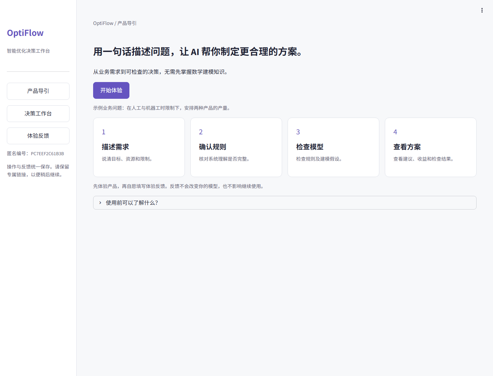
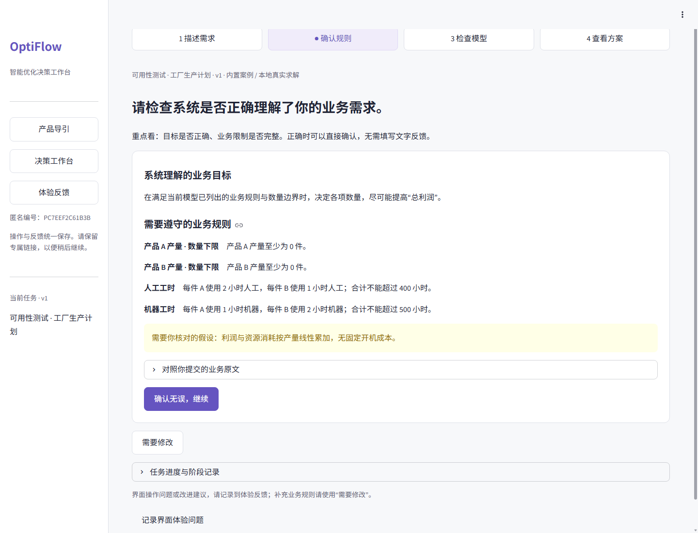
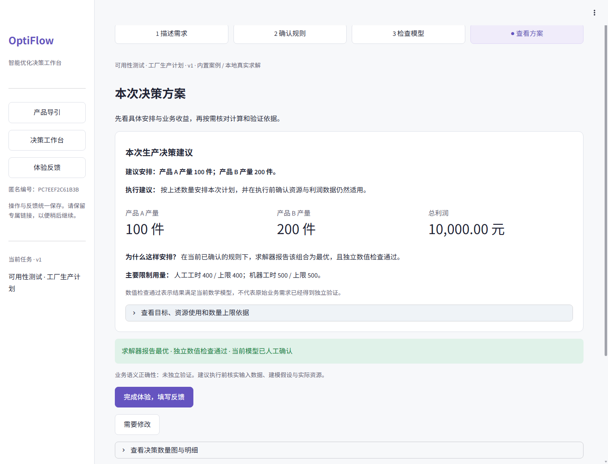

# OptiFlow｜AI 智能优化决策工作台

> 我希望让不了解运筹优化的人，也能把业务问题转成**看得懂、能修改、有依据的决策方案**。

[](https://optiflow-cassie.streamlit.app/)


[](https://github.com/Jiaxin-Cassie/optiflow-demo/actions/workflows/check.yml)

**[在线体验](https://optiflow-cassie.streamlit.app/)** · [产品需求](OptiFlow-PRD.md) · [产品决策与迭代](docs/PRODUCT-DECISIONS.md) · [技术架构](docs/ARCHITECTURE.md) · [部署说明](docs/RESUME-DEPLOY.md) · [Figma 设计](https://www.figma.com/design/XwyaSk6o5YOEOAHBaxAXdI?node-id=10-274)

我设计了一个无需登录的体验入口：点击「开始体验」，选择生产计划案例，确认业务规则、检查模型并计算方案，再补充数量限制，比较修改前后的结果。

**上线后的首轮反馈**：我邀请了 **15 位用户**体验 Demo，自动建模与调整功能的好评率约 **90%**，业务范围相关的差评率为 **40%**。接下来我会优先扩展业务场景和可调整的规则类型。[查看反馈与迭代计划](#五用户反馈与体验迭代)

**演示范围**：公开 Demo 使用预置业务模型并真实求解，不调用付费 LLM。仓库同时保留原 Agent 的实时建模能力，配置模型服务后可在本机处理自定义需求。



## 目录

- [一、为什么做](#一为什么做)
- [二、产品定位与用户价值](#二产品定位与用户价值)
- [三、核心产品设计](#三核心产品设计)
- [四、功能模块与用户流程](#四功能模块与用户流程)
- [五、用户反馈与体验迭代](#五用户反馈与体验迭代)
- [六、产品指标与验证](#六产品指标与验证)
- [七、架构与技术取舍](#七架构与技术取舍)
- [八、快速开始](#八快速开始)
- [九、代码组织](#九代码组织)
- [十、路线图与能力边界](#十路线图与能力边界)
- [十一、常见问题](#十一常见问题)

## 一、为什么做

做这个项目时，我从“工厂生产多少”“营销预算怎么分”“客服怎么排班”这类问题入手。我想解决的不只是计算，还包括业务人员如何检查 AI 的理解、修改规则，以及判断方案是否符合实际要求。

| 用户问题 | 单次生成答案的不足 | OptiFlow 的处理 |
| --- | --- | --- |
| 需求里包含哪些目标和限制？ | 容易只看到代码或公式 | 先展示通俗的业务理解，再展开专业模型 |
| 系统有没有遗漏我的要求？ | 代码能运行，并不能说明模型符合原意 | 目标、变量、约束和原文依据可以核对 |
| 我补充了要求，旧方案还能用吗？ | 修改后的模型与旧答案容易混用 | 新版本使原确认和当前结果失效，保留历史记录 |
| 算出的方案能直接执行吗？ | “求解成功”容易被理解为“业务正确” | 求解器状态、数值检查和人工复核分别展示 |

因此，我把使用过程整理为：**描述需求 → 确认理解 → 检查模型 → 查看方案 → 修改与复算**。

## 二、产品定位与用户价值

我把 OptiFlow 定位为面向非优化专业用户的 AI 优化决策工作台，先帮助用户理解和核对业务规则，再提供模型和求解细节。

| 用户 | 需要解决的事情 | 产品提供的价值 |
| --- | --- | --- |
| 业务人员、运营人员 | 把目标和资源限制转成具体安排 | 使用自然语言描述问题，先看业务解释和决策建议 |
| 管理者、方案审核者 | 判断规则是否完整、方案是否符合业务 | 人工确认、来源对照、修改记录和版本比较 |
| 专业分析人员 | 检查变量、公式、求解状态和数值依据 | 可展开的数学模型、JSON、代码、日志及约束残差 |

### 与常见解决路径的取舍

在确定功能范围时，我比较了几种解决路径，整理了各自适合处理的问题和需要补充的环节。

| 解决路径 | 适合做什么 | 仍需补上的环节 |
| --- | --- | --- |
| 通用对话助手 | 解释概念、起草模型与代码 | 让确认、修订、求解与检查形成持续任务 |
| 优化建模工具或求解器 | 表达和计算已定义好的模型 | 帮非专业用户理解业务条件如何进入模型 |
| 通用 Agent 编排 | 连接自动化阶段 | 定义用户何时检查、何时确认，以及哪些状态能继续 |
| **OptiFlow** | 将业务理解、人工确认和数值求解放进同一工作区 | 当前聚焦线性与混合整数线性问题，场景范围有明确边界 |

## 三、核心产品设计

### 1. 两次确认，分别回答两个问题

- **确认业务规则**：系统是否正确理解目标和限制？理解正确可直接继续，无需填写文字反馈。
- **检查并确认模型**：决策对象、单位、边界和假设是否代表当前业务？确认后才进入求解。

确认绑定当前模型的版本和指纹。主工作区、步骤导航和后台求解接口使用一致的状态检查，不能通过换一个入口跳过必要确认。

### 2. 需求改了，确认和结果也要跟着更新

用户可以补充“产品 A 最多生产 100 件”。系统保存旧版本，记录变更，重新生成模型，并清除当前确认和求解结果；旧方案只能在历史中查看。

内置案例支持单个数量上限、下限或固定值，也提供“选择产品和数量”的结构化输入。任意自定义需求使用本机实时建模模式。

### 3. 将结果的可信程度拆开表达

| 状态 | 表示什么 | 不表示什么 |
| --- | --- | --- |
| 求解器报告最优 | 对当前数学模型获得最优求解状态 | 原始业务要求一定表达完整 |
| 数值检查通过 | 独立重算约束、边界、整数性及目标值通过 | 已证明业务语义正确 |
| 人工复核完成 | 用户确认了当前版本的业务含义 | 数学正确性的形式化证明 |

不可行、无界、执行失败或校验不通过时，不展示成功的推荐方案。

## 四、功能模块与用户流程

| 模块 | 主要能力 | 所在位置 |
| --- | --- | --- |
| 产品导引 | 价值说明、唯一主入口、示例业务问题 | 首次进入 |
| 描述需求 | 内置案例、任务类别；本机支持自然语言实时建模及技能选择 | 工作台第 1 步 |
| 确认规则 | 业务目标、资源限制、假设与缺失信息 | 工作台第 2 步 |
| 检查模型 | 决策对象、原文对照、公式、JSON 与修改入口 | 工作台第 3 步 |
| 求解与验证 | 推荐决策量、业务指标、资源用量、数值检查和导出 | 工作台第 4 步 |
| 版本与追溯 | 修改历史、模型变化、方案比较、阶段事件及耗时 | 按需展开的详情 |
| 体验反馈 | 独立可选问卷，提交后可继续使用 | 侧栏及每步末尾入口 |
| 测试管理 | 专属邀请、参与者隔离、历史记录与统一 CSV 导出 | 正式测试后台 |

```text
描述业务需求
    ↓
生成可检查模型 → 确认业务理解 → 检查并确认模型
                    ↑                ↓
                    └─ 补充要求 ← 需要修改
                                     ↓ 确认后
                           受控求解 → 独立数值检查
                                     ↓
                           决策建议、版本比较与导出

体验反馈独立于这条业务流程，不作为继续求解的门槛。
```

### 用生产计划案例体验一次需求修改

工厂案例中，A 每件利润 40 元，B 每件利润 30 元；每件 A 消耗 2 小时人工、1 小时机器，每件 B 消耗 1 小时人工、2 小时机器，可用人工 400 小时、机器 500 小时。

| 操作 | 真实求解结果 | 产品如何解释 |
| --- | --- | --- |
| 初始模型确认并求解 | A=100，B=200，总利润 10000 元 | 给出具体生产安排和资源使用依据 |
| 补充 A 最多生产 100 件，重新确认并计算 | 数量和利润保持不变 | 新约束已进入模型，原方案仍满足限制，不人为制造变化 |
| 将上限收紧到 80 件，重新确认并计算 | A=80，B=210，总利润 9500 元 | 展示数量组合和目标值的实际变化 |

我用这个内置案例检查修改、重新确认和求解是否衔接正确；表中的利润来自案例计算。





## 五、用户反馈与体验迭代

### 上线后，我邀请了 15 位用户体验

我希望了解两件事：用户是否认可“自动建模后还能调整”的方式，以及当前案例能否覆盖他们想解决的问题。

| 反馈项 | 本轮结果 | 我的判断与后续行动 |
| --- | --- | --- |
| 自动建模与调整功能 | 好评率约 **90%** | 保留业务规则核对、自然语言修改和重新求解，让用户能够参与建模过程 |
| 当前业务范围 | 相关差评率 **40%** | 场景覆盖是下一轮的优先问题；先梳理用户希望处理的业务，再扩展案例和规则类型 |

本轮共 15 位体验用户，比例来自体验后的反馈汇总，90% 为约数。两项评价针对不同功能，不合并为整体满意度；这轮反馈也不能用来推算建模准确率或效率提升。公开仓库只展示汇总，不上传参与者身份和原始回答。

### 我已经根据操作反馈调整了哪些地方

除了功能评价，用户还指出了字号、开始入口和操作顺序的问题。我据此重做了主要页面和流程。

| 用户反馈 | 设计调整 | 实现与验证 |
| --- | --- | --- |
| 字小、阅读费力 | 正文 16px、辅助 14px、标题 28px，提高对比度 | 统一主题，验证桌面与 390px 窄屏 |
| 不知道从哪里开始 | 独立导引页，一个明确的开始按钮 | 从空白会话进入案例体验 |
| 测试记录与计算入口造成跳步 | 四阶段业务状态统一，体验问卷独立 | 服务层检查当前版本的两次确认 |
| 信息缺乏主次 | 默认展示业务含义，专业信息折叠 | 保留模型、代码、日志和残差入口 |
| 不知道下一步做什么、哪里记录问题 | 每步说明检查重点，提供明确操作与问题入口 | 正确时直接确认，需要修改再补充 |

设计记录见 [产品决策与迭代](docs/PRODUCT-DECISIONS.md) 和 [UI/UX 审查与验收](docs/UX-REDESIGN.md)。目前，我还没有用前后对照测试衡量这些调整对任务完成率的影响。

## 六、产品指标与验证

下一轮，我会重点观察用户能否完成一份经过确认、数值检查通过的方案，同时记录在哪一步遇到困难。

| 指标 | 用途 | 当前依据 |
| --- | --- | --- |
| 模型确认、需求修订、失败阶段与耗时 | 定位流程阻塞和需要修改的环节 | SQLite 任务快照与事件 |
| 体验是否完成、问卷是否提交 | 分别观察产品操作与反馈行为 | 独立记录，未填问卷不影响业务流程 |
| 易用度、下一步清晰度、困难环节及问题原文 | 为下一轮体验迭代提供线索 | 五项版本化问卷 |
| 约束违反量、求解状态 | 检查当前方案的数值可用性 | 独立重算，不替代业务语义验证 |

工程方面，我运行了 **79 项回归测试**、三个案例的真实求解，以及已部署 Demo 的未登录浏览器验证。用户体验评价见上一节；这些工程检查用于验证程序行为，两类结果分别记录。

## 七、架构与技术取舍

```text
Streamlit 页面与会话
        ↓
任务服务：创建 / 修订 / 业务确认 / 模型确认
        ├── Agent 适配层 → 需求解析 / 技能检索 / 数学建模
        └── 内置案例模型 → 明确标注来源
        ↓
受控模型解释与独立求解进程（CVXPY / SciPy / HiGHS）
        ↓
数值检查 / 决策解释 / 版本比较
        ↓
SQLite：任务、事件、确认、失败记录和问卷
```

| 决策 | 当前选择 | 取舍理由 |
| --- | --- | --- |
| 交互框架 | Streamlit | 优先验证用户决策流程，复用 Python 能力 |
| 建模能力 | 复用原 Agent，增加统一任务适配层 | 避免为产品界面重写已稳定的内部逻辑 |
| 执行入口 | 解释已确认的结构化模型 | AI 生成代码用于审阅，不直接执行任意生成代码 |
| 模型范围 | LP / MILP | 在可解释、可检查的范围内完成闭环 |
| 公开 Demo | 三类内置案例、真实计算 | 不依赖访客配置密钥，不伪装为实时 LLM 生成 |
| 数据存储 | SQLite、版本快照和事件 | 适合当前单实例验证；长期云端调研需可靠持久存储 |

详见 [模块职责与状态规则](docs/ARCHITECTURE.md)。

## 八、快速开始

我使用 **Python 3.11** 运行这个项目。创建并激活虚拟环境后，执行：

```bash
git clone https://github.com/Jiaxin-Cassie/optiflow-demo.git
cd optiflow-demo
python -m pip install -r requirements.txt
python run_experiment.py --public-demo
```

打开 `http://127.0.0.1:8501`，无需模型密钥即可体验内置案例。

本机完整工作台：

```bash
python run_experiment.py --workbench
```

实时建模通过进程环境变量配置 `DEEPSEEK_API_KEY`、`DEEPSEEK_BASE_URL` 和 `LLM_MODEL`，由 `src/config.py` 统一读取；`.env.example` 仅为配置示例，不自动加载。所有 LLM 调用统一经过 `src/llm_client.py`，提示词集中在 `src/prompts.py`。

运行检查：

```bash
python run_experiment.py --method all --dry_run
python run_experiment.py --workbench-test
```

云端入口为 `resume_demo.py`。更多说明见 [启动与 CLI](DEPLOY-GUIDE.md)、[公开 Demo 部署](docs/RESUME-DEPLOY.md)、[正式测试部署](docs/ONLINE-STUDY.md)。

## 九、代码组织

```text
optiflow-demo/
├── README.md                  # 产品定位、设计取舍与体验入口
├── run_experiment.py           # 本地运行、检查、打包的统一入口
├── resume_demo.py              # Streamlit Cloud 公开应用入口
├── requirements.txt
├── .streamlit/                 # 主题与服务配置
├── .github/workflows/          # 自动化产品检查
├── src/
│   ├── agents/                 # 需求解析、技能路由、建模、代码审阅与评估
│   ├── workbench/              # 页面、任务服务、状态、求解、验证、隔离与存储
│   ├── config.py              # 服务配置；发布版本无内置密钥
│   ├── llm_client.py          # 统一模型调用
│   └── prompts.py             # 集中管理提示词
├── skill_library/              # 当前建模技能库
├── tests/                      # 服务、求解、权限、历史兼容与 UI 回归
├── docs/                       # 文档导航、架构、设计决策、部署和真实截图
└── deploy/                     # 正式测试的 HTTPS 代理配置
```

`runtime/` 在运行时创建并被 Git 忽略。公开仓库不包含本机密钥、真实问卷、任务数据库、虚拟环境或旧科研数据。

## 十、路线图与能力边界

- [x] 四阶段业务流程与版本绑定的确认机制。
- [x] 生产计划、营销预算、客服排班三个案例与真实求解。
- [x] 原文对照、需求修改、当前结果失效、版本比较和数值检查。
- [x] 独立体验反馈、受邀测试隔离、管理员统一导出。
- [x] Figma 设计、桌面与窄屏适配、固定在线 Demo。
- [x] 邀请 15 位用户体验，整理功能评价与业务范围反馈。
- [ ] 优先扩展业务场景：梳理这轮反馈中的场景需求，补充案例、支持规则和适用边界。
- [ ] 扩展内置案例可修改的规则类型，并提供更清晰的不可行原因解释。
- [ ] 围绕新增场景开展下一轮测试，观察场景覆盖评价、任务完成率和用户卡住的位置。
- [ ] 为长期在线调研接入持久数据库、备份和更完善的资源控制。
- [ ] 在明确任务边界和成本控制后开放更多自定义在线建模能力。

我目前把它作为个人产品项目持续迭代。五要素模型是沿用的标准化中间表示，我的设计重点是让用户能核对规则、修改需求，并追溯到实际求解结果。生产级多租户服务仍需要进一步建设。

## 十一、常见问题

**为什么在线 Demo 没有调用 LLM？** 公开版本聚焦交互与决策闭环，预置模型的来源明确标注，计算仍真实执行。自定义需求可在本机完整工作台配置服务后运行。

**为什么增加一条约束，结果可能没变？** 如果原最优方案已经满足新约束，重新计算可以得到相同结果。模型变化与结果变化分别呈现。

**确认以后就代表答案正确吗？** 不代表。人工确认表达业务复核，数值检查表达当前模型的可行性；业务语义正确性仍未独立验证。

**反馈会影响求解吗？** 不会。体验反馈与业务修改使用不同接口，填写问卷不是继续操作的条件。

**固定链接需要我的电脑开机吗？** 不需要。应用在 Streamlit Community Cloud 运行。免费托管闲置后可能休眠，访问时需要唤醒；其本地文件不作为可靠的长期调研存储。

更多资料从 [文档导航](docs/README.md) 开始阅读。
